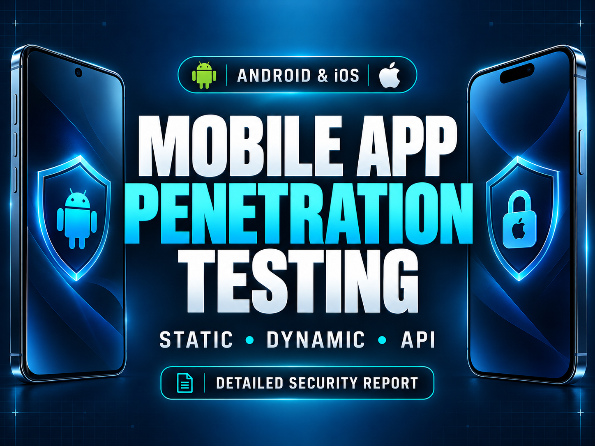
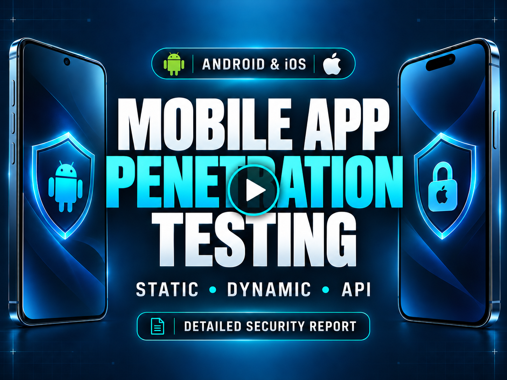
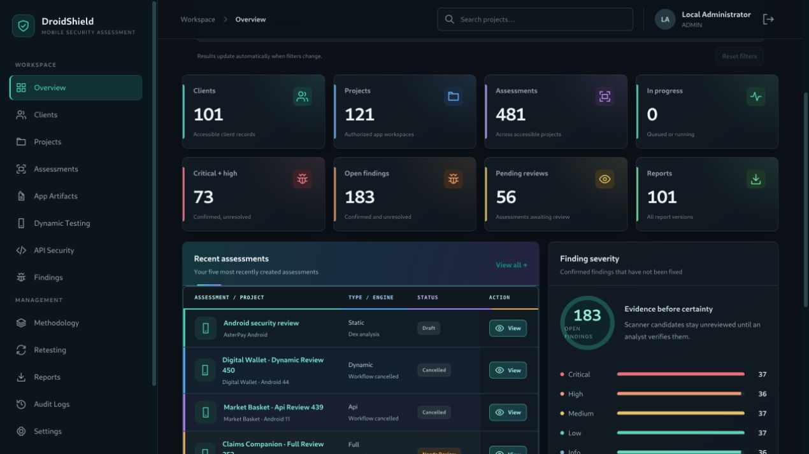
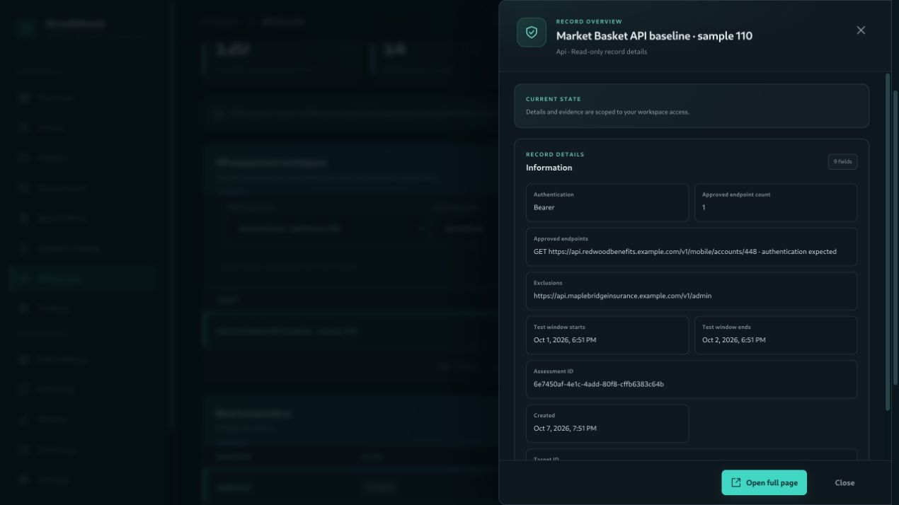
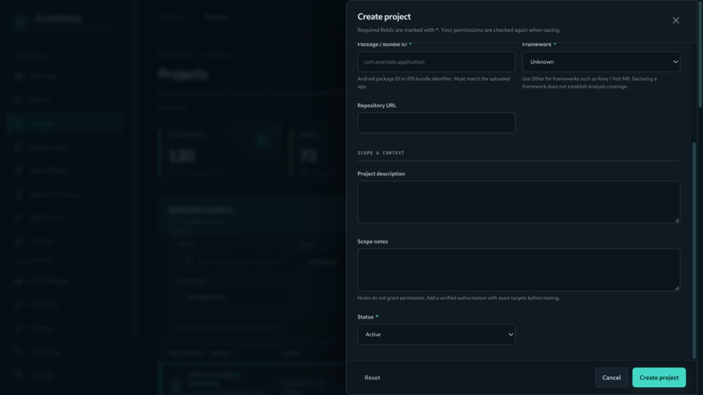
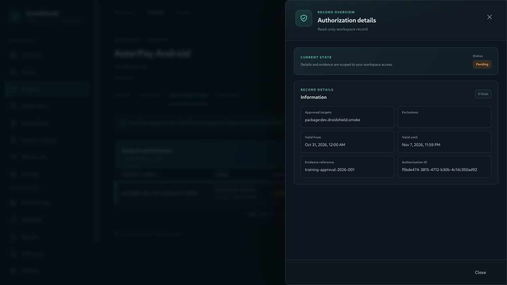
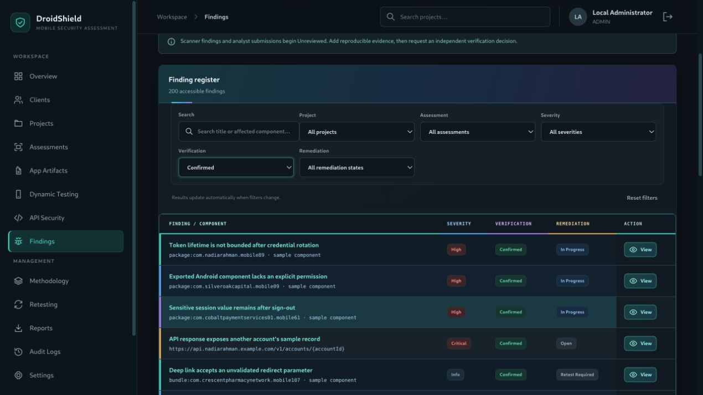
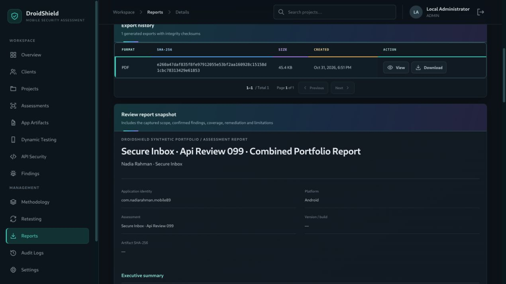
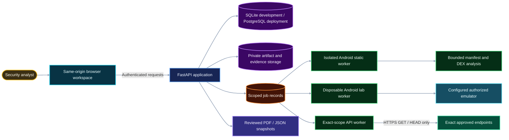

<a id="top"></a>

<h1 align="center">🛡️ DroidShield</h1>

<p align="center"><strong>An analyst-led workspace for authorized Android and iOS security assessments</strong></p>

<p align="center">Authorization · Protected Builds · Android Analysis · Scoped API Checks · Evidence · Retesting · Reports</p>

<p align="center">
  <a href="#quick-start"></a>
  <a href="#project-demo"></a>
  <a href="#safe-use"></a>
  <a href="https://github.com/sahadatx/DroidShield/actions/workflows/ci.yml"></a>
</p>

<p align="center"></p>

<p align="center">
  
  
  
  
</p>

<hr>

<a id="overview"></a>

## 📖 Overview

DroidShield organizes authorized mobile assessments—from client and scope records to protected app intake, bounded analysis, reviewed findings, retesting, and report delivery.

> **Project status:** DroidShield is an evolving assessment workspace, not a comprehensive scanner or a substitute for a qualified tester. Much of a full Android or iOS assessment remains analyst-led.

## 📑 Contents

- [Overview](#overview)
- [Project demo](#project-demo)
- [Workspace screenshots](#workspace-screenshots)
- [Capabilities](#capabilities)
- Assessment design
  - [Architecture](#architecture)
  - [Assessment workflow](#assessment-workflow)
  - [Automation boundaries](#automation-boundaries)
  - [Reports](#reports-and-exports)
- Setup and use
  - [Quick start](#quick-start)
  - [Workers](#workers)
  - [Deployment and configuration](#deployment)
  - [API and testing](#api-and-testing)
- Project
  - [Documentation](#documentation)
  - [Project structure](#project-structure)
  - [Safe use](#safe-use)
  - [Contributing](#contributing)
  - [Author](#author)

<a id="project-demo"></a>

## 🎥 Project Demo

Click the thumbnail to watch a DroidShield walkthrough using fictional assessment records.

<p align="center">
  <a href="images/Video.mp4">
    
  </a>
</p>

<a id="workspace-screenshots"></a>

## 📸 Workspace Screenshots

These fictional dark-theme screens show the workflow; they contain no client data.

| Overview | API security |
|:---:|:---:|
|  |  |
| Project setup | Scope review |
|  |  |
| Findings review | Report delivery |
|  |  |

<a id="capabilities"></a>

## ✨ Capabilities

- **Engagements:** Client/project records, platform and app identity, authorization, exact scope, exclusions, team access, and audit history.
- **Protected intake:** Private APK/AAB/IPA storage with server-calculated hashes and bounded metadata parsing.
- **Controlled analysis:** Isolated Android manifest/DEX checks, an optional fixed MobSF adapter, configured disposable Android runtime, and exact-scope API checks.
- **Analyst-led delivery:** Versioned methodology, sanitized evidence, independent finding review, evidence-backed retesting, and frozen PDF/JSON reports.
- **Browser workspace:** Same-origin authenticated API and server-managed sessions.

Coverage is partial and evidence-led. Automated observations do not confirm vulnerabilities; APK/AAB/IPA intake does not imply full binary coverage.

<a id="architecture"></a>

## 🏗️ Architecture

A same-origin browser workspace uses the FastAPI service. SQLite is for local development; shared and production deployments use PostgreSQL. Protected files stay outside the public web root, and eligible jobs run in separate workers.



<a id="assessment-workflow"></a>

## 🔄 Assessment Workflow

```mermaid
flowchart LR
  subgraph scope["01 · SCOPE"]
    Client([Client and project]) --> Authorization[Authorization and exclusions]
  end
  subgraph intake["02 · INTAKE"]
    Build[App build or exact API endpoints] --> Review[Identity and scope review]
  end
  subgraph assess["03 · ASSESS"]
    Review --> Execute[Eligible bounded worker or manual engagement]
    Execute --> Evidence[Coverage, evidence, and candidate findings]
  end
  subgraph delivery["04 · REVIEW AND DELIVER"]
    Evidence --> Independent[Independent administrator review]
    Independent --> Retest[Evidence-backed retest]
    Retest --> Report[Approved report snapshot]
  end
  Authorization --> Build

  classDef scopeNode fill:#142D4D,stroke:#60A5FA,color:#EFF6FF,stroke-width:2px
  classDef intakeNode fill:#0F3436,stroke:#2DD4BF,color:#ECFEFF,stroke-width:2px
  classDef assessNode fill:#3A2C12,stroke:#FBBF24,color:#FFFBEB,stroke-width:2px
  classDef deliveryNode fill:#2E1E4D,stroke:#C4B5FD,color:#F5F3FF,stroke-width:2px
  class Client,Authorization scopeNode
  class Build,Review intakeNode
  class Execute,Evidence assessNode
  class Independent,Retest,Report deliveryNode
  style scope fill:#0D1B2A,stroke:#60A5FA,color:#DBEAFE,stroke-width:2px
  style intake fill:#0A2528,stroke:#2DD4BF,color:#CCFBF1,stroke-width:2px
  style assess fill:#2A210F,stroke:#FBBF24,color:#FEF3C7,stroke-width:2px
  style delivery fill:#201638,stroke:#C4B5FD,color:#EDE9FE,stroke-width:2px
  linkStyle default stroke:#94A3B8,stroke-width:2px
```



Manual engagement records document analyst work performed outside the app; they do not launch external tools or prove a target was tested by DroidShield.

<a id="automation-boundaries"></a>

## 🧪 Automation Boundaries

| Area | What runs | Important limit |
|:---|:---|:---|
| **APK** | Isolated manifest and selected DEX analysis; optional configured MobSF normalization. | Results are candidates for review; no source or dependency scan is implied. |
| **AAB / IPA** | Protected intake and bounded package metadata inspection. | Not full bundle, binary, signature, entitlement, or runtime analysis. |
| **Android runtime** | Fixed observations on an explicitly configured disposable emulator. | No physical-device selection, custom Frida scripts, or pinning bypass. |
| **API baseline** | Exact approved HTTPS endpoints using bounded `GET`/`HEAD` comparisons. | No broad crawl; a response comparison alone does not prove BOLA/IDOR. |
| **External procedures** | Record analyst methods, versions, environment, outcomes, and evidence. | Recording a procedure does not run Burp, Objection, iOS tools, or other external software. |
| **CycloneDX 1.6** | Normalize a supplied inventory into component records and unreviewed candidates. | Does not run SCA, validate provenance, or assess reachability. |

The local procedure library maps to MASVS 2.1.0. Untouched procedures remain **Not Run**; it is not an exhaustive MASTG catalog.

<a id="reports-and-exports"></a>

## 📄 Reports

Reports are immutable, versioned snapshots from completed assessments. A different administrator must approve a snapshot before export. Only confirmed findings and reviewed retests are included.

- **PDF:** Executive or technical report with scope, coverage, limitations, and approved content.
- **JSON:** Approved snapshot, provenance, review metadata, and integrity digest.

Report export does not certify compliance or guarantee that all vulnerabilities were found. See [reporting and scoring](docs/reporting.md).

<a id="quick-start"></a>

## 🚀 Quick Start

**Requirements:** Python 3.11+ and Linux. APK analysis additionally requires Bubblewrap (`bwrap`), working unprivileged user namespaces, and a trusted system Python under `/usr`. Run the API and workers as an unprivileged account; APK analysis fails closed if isolation is unavailable or the process is host root.

```bash
python3 -m venv .venv
source .venv/bin/activate
python -m pip install -e '.[dev]'
cp .env.example .env
droidshield migrate
droidshield bootstrap --workspace DroidShield --email analyst@example.com --name 'Workspace Admin'
droidshield set-password --user-id USER_ID_FROM_BOOTSTRAP
uvicorn droidshield.main:create_app --factory --host 127.0.0.1 --port 8787
```

Use the ID printed by `bootstrap`; the password command prompts without echoing it. Open <http://127.0.0.1:8787/> and sign in. Browser authentication uses an `HttpOnly` session cookie; no default account is seeded. Keep `.env` private.

<a id="workers"></a>

## ⚙️ Workers

Workers run separately from the browser/API service. Queueing alone never starts a scan.

| Command | Work type |
|:---|:---|
| `droidshield worker` | APK static analysis and configured MobSF jobs. |
| `droidshield dynamic-worker` | Configured disposable Android emulator sessions. |
| `droidshield api-worker` | Exact approved HTTPS API checks. |

Add `--once` to process at most one eligible job. Dynamic and API jobs also require their respective lab/network configuration and current authorization.

<a id="deployment"></a>

## 🖥️ Deployment and Configuration

SQLite is for local development; shared/production deployments require PostgreSQL, HTTPS, protected storage outside the web root, separate restricted service/worker identities, and network egress controls. The application account should not own tables or have DDL privileges.

Settings use `.env` and `DROIDSHIELD_*` variables. See [`.env.example`](.env.example) for the complete list. Configure only the required lab devices, network allowlists, and fixed external services; a configuration flag alone does not establish readiness. Never commit secrets, and do not treat application CIDR checks as a replacement for firewall rules.

See the [deployment and recovery guide](docs/operations.md) and [release readiness checklist](docs/release-checklist.md) before a shared deployment.

<a id="api-and-testing"></a>

## 🔌 API and Testing

The API is versioned under `/api/v1`. Local interactive docs are at <http://127.0.0.1:8787/docs>; see the [API contract](docs/api-contract.md) for access rules and request/response details.

Run the main checks locally:

```bash
pytest
ruff check backend tests
ruff format --check backend tests
alembic check
node --test tests/frontend.mjs
```

Node.js 22+ is needed for browser tests only. PostgreSQL tests use `DROIDSHIELD_TEST_DATABASE_URL` and isolated schemas when configured. GitHub Actions runs the project checks on pushes and pull requests; see [Actions](https://github.com/sahadatx/DroidShield/actions) for current results.

<a id="documentation"></a>

## 📚 Documentation

- [Service coverage](docs/service-delivery.md) · [Analyst workflow](docs/analyst-workflow.md) · [Reports and scoring](docs/reporting.md)
- [Product blueprint](docs/blueprint.md) · [Browser interface](docs/frontend.md) · [API contract](docs/api-contract.md)
- [Protected uploads](docs/upload-worker.md) · [DEX analysis](docs/dex-analysis.md) · [MobSF adapter](docs/mobsf.md)
- [Android lab](docs/dynamic-lab.md) · [Frida](docs/frida.md) · [HTTPS proxy](docs/proxy.md) · [API security worker](docs/api-security.md)
- [Deployment](docs/operations.md) · [Release checklist](docs/release-checklist.md) · [Verification history](docs/verification.md)

<a id="project-structure"></a>

## 📁 Project Structure

```text
DroidShield/
├── backend/droidshield/       FastAPI app, models, services, workers, and engines
├── tests/                     Backend, migration, sandbox, worker, and frontend tests
├── docs/                      Product, security, delivery, and operations guides
├── images/                    Banner, video, thumbnail, and synthetic screenshots
├── scripts/                   Verification and runtime helpers
└── .github/workflows/         CI and integration smoke workflows
```

<a id="safe-use"></a>

## 🛡️ Safe Use

> **Authorized testing only.** Use local fixtures or targets covered by current written authorization. Confirm exact scope, exclusions, methods, test window, request limits, and stop conditions before execution.

- API/proxy traffic is limited to exact approved HTTPS endpoints and `GET`/`HEAD`; TLS verification stays enabled and redirects are not followed.
- Android runtime work requires configured disposable emulators. No physical device is auto-selected, no custom Frida script is accepted, and certificate pinning is not bypassed.
- Treat APK/AAB/IPA files as untrusted. Metadata intake and successful scanner jobs do not establish full coverage or confirm findings.
- Manual records document analyst work; they do not execute arbitrary tools. Reports are not compliance certification.

<a id="contributing"></a>

## 🤝 Contributing

Focused issues and pull requests are welcome. Include user-visible behavior, security boundaries, migration impact, and documentation updates; never use real client data or credentials in fixtures. Run relevant checks from [API and Testing](#api-and-testing).

<a id="author"></a>

## Author

**Sahadat Hossain**

Cybersecurity Researcher • Penetration Tester • Python Developer

### Contact

- 📧 **Email:** [pentester.sahadathossain@gmail.com](mailto:pentester.sahadathossain@gmail.com)
- 💼 **LinkedIn:** [linkedin.com/in/pentester-sahadat-hossain](https://www.linkedin.com/in/pentester-sahadat-hossain/)
- 🐙 **GitHub:** [github.com/sahadatx](https://github.com/sahadatx)
- 🌐 **Portfolio:** [sahadatx.github.io/Personal-Portfolio](https://sahadatx.github.io/Personal-Portfolio/)

> Feel free to connect for collaboration, security research, or open-source contributions.

---

If you found this project useful, consider supporting it by:

- ⭐ Starring the repository
- 🍴 Forking the project
- 🤝 Contributing improvements
- 📢 Sharing it with others

---

<p align="center">
Made with ❤️ by <strong>Sahadat Hossain</strong>
</p>

<p align="right">
<a href="#-overview">⬆️ Back to Top</a>
</p>
